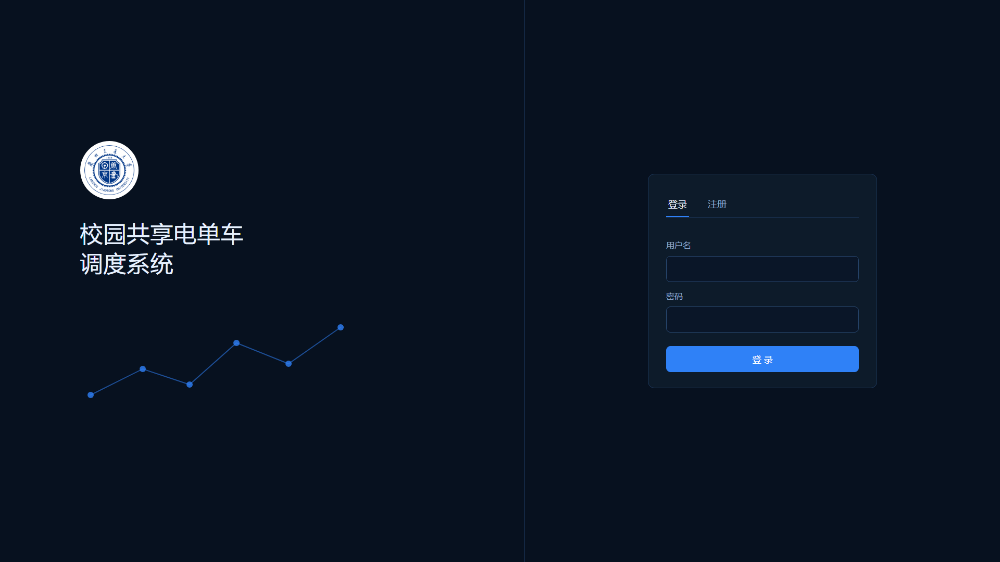
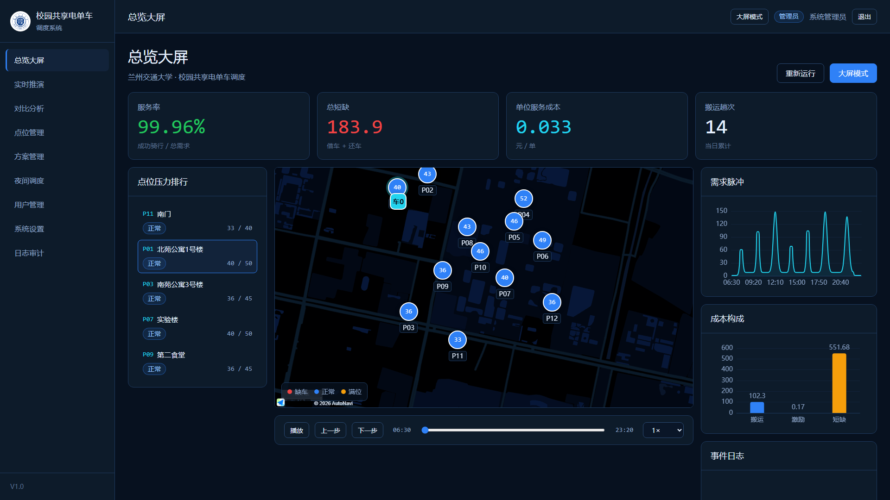
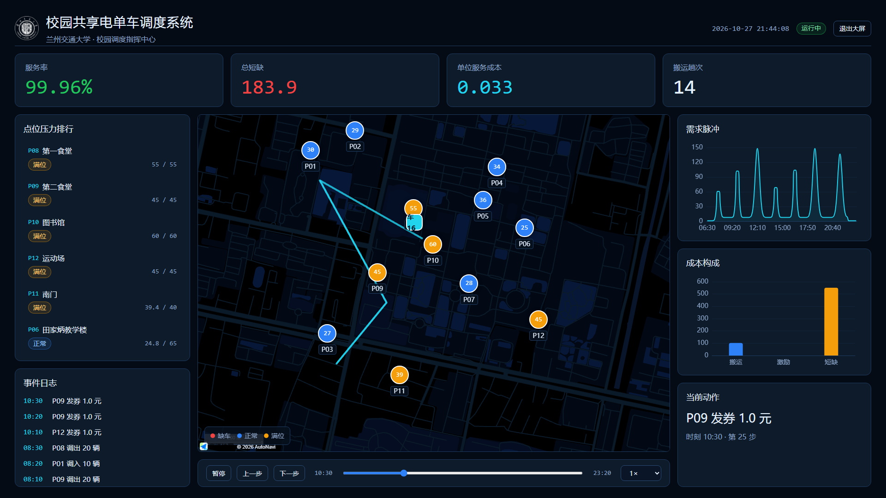
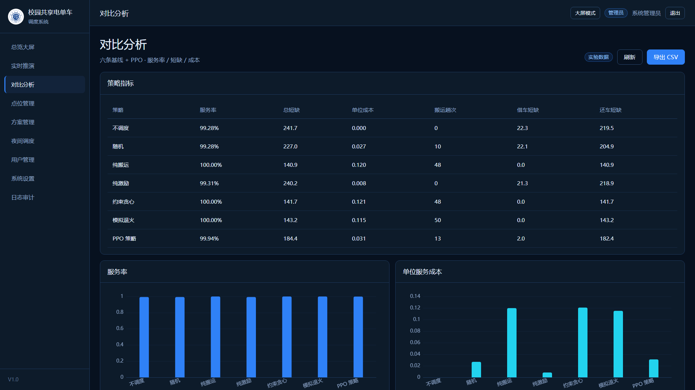

# 校园共享电单车调度系统

面向交科赛演示的完整 Web 系统：登录 / 角色权限 / 点位管理 / 方案管理 / 实时推演 / 对比分析 / 夜间调度 / 用户管理 / 系统设置 / 日志审计 / 1920×1080 大屏。

- 后端：FastAPI + SQLAlchemy + SQLite + JWT + WebSocket
- 前端：Vue 3 + Vite + Pinia + Vue Router + ECharts 5 + Three.js（数字孪生）+ 高德 JS API 2.0（点位管理）
- 算法：复用 `../src/bike_sched`（PPO + 夜间 MILP），不复制算法代码

## 界面

| 登录 | 总览 |
|---|---|
|  |  |

| 大屏 | 对比分析 |
|---|---|
|  |  |

更多：`docs/screenshots/`（点位、方案、夜间、用户、设置、日志）。

## 功能

- **登录 / 注册**：本地账号；注册后进入待审核，管理员通过后启用；首次登录强制改密
- **角色**：`admin`（全部）/ `operator`（调度、点位、方案）/ `viewer`（只读）
- **数字孪生大屏**：Three.js 校园建筑、绿地与运动场地、带描边的路网、发光边界、P 点光柱、三轮车、需求流、Bloom、开场镜头、实时图表与回放
- **昼夜主题**：顶部一键切换「白天 / 夜间」，切换背景、地面、建筑、道路、灯光与泛光，不重建场景
- **楼名图层**：22 个校园建筑名称，顶部「楼名」一键显示/隐藏，样式接近地图注记
- **实时数据流（L3）**：按真实时间 1:1 推进的租还事件流与车辆位置，库存、在途车辆、围栏告警实时更新；下发调度指令生成金色弧线与落点涟漪，并支持未来 30 分钟供需缺口预演
- **实时推演**：PPO / 贪心 / 不调度；开始、暂停、单步、倍速、拖拽；WebSocket 服务端推送
- **对比分析**：六条基线 + PPO，服务率 / 短缺 / 成本 / 搬运趟次，导出 CSV
- **点位管理**：P 点增删改、CSV 导入导出、容量/功能/初始库存
- **方案管理**：保存策略与种子，一键运行
- **夜间调度**：MILP 求解、路径、调度前后库存、各点调动量
- **用户管理**：新建、审核、角色、重置密码、删除
- **系统设置**：系统名称、自助注册开关、默认策略、地图样式
- **日志审计**：登录、注册、增删改、推演、夜间调度
- **大屏模式**：`/screen`，1920×1080 固定画布缩放，数字孪生自动播放，3 秒隐藏鼠标；`?record=1` 隐藏退出按钮，便于录屏
- **点位清空状态**：无点位时仍展示三维校园，并引导进入点位管理；点位重新标定后自动接入库存、车辆与路径

## 快速启动

### 1. 安装依赖

```bash
# 在 代码/ 目录
pip install -r requirements.txt

# 前端
cd system/frontend
npm install --registry=https://registry.npmmirror.com
npm run build
```

### 2. 启动

**推荐双击 `system\start.bat`**（脚本会自动使用项目虚拟环境）。

或在 `代码/` 目录执行：

```bash
C:\Users\Fasder\.workbuddy-ai\binaries\python\envs\bike_sched\Scripts\python.exe system\run.py
```

浏览器打开：

```
http://127.0.0.1:8000
```

> 不要用系统默认的 `python system\run.py`：本机默认 Python 没有安装 FastAPI。
> 如果浏览器打不开或显示 502，说明服务没启动，请先运行 `start.bat` 并保持窗口不要关闭。

### 3. 默认账号

```
用户名：admin
密码：admin123
```

首次登录会要求修改密码。界面不展示默认账号。

### 4. 开发模式

```bash
# 终端 1：后端
cd system/backend
python -m uvicorn app.main:app --reload --port 8000

# 终端 2：前端
cd system/frontend
npm run dev
# http://127.0.0.1:5173
```

## 目录

```
system/
├── backend/
│   ├── app/
│   │   ├── main.py          FastAPI 入口、静态托管、SPA 回退
│   │   ├── core/            配置、数据库、JWT/bcrypt/RBAC
│   │   ├── api/             auth/users/stations/scenarios/simulations/meta
│   │   ├── services/        算法适配、审计
│   │   ├── ws.py            WebSocket 推演
│   │   ├── models.py        SQLAlchemy 模型
│   │   ├── schemas.py       Pydantic
│   │   └── seed.py          首次启动种子数据
│   ├── static/logo.png      校徽
│   └── requirements.txt
├── frontend/
│   ├── src/
│   │   ├── views/           Login/Dashboard/Screen/Simulation/Compare/
│   │   │                    Stations/Scenarios/Night/Users/Settings/Logs
│   │   ├── components/      Panel/KpiCard/MapPanel/EChart/Timeline
│   │   ├── layouts/         AppLayout
│   │   ├── stores/          auth
│   │   ├── router/          路由与角色守卫
│   │   └── styles/          tokens.css / app.css
│   ├── public/logo.png
│   └── vite.config.js
├── docs/
│   ├── 系统实现方案.md
│   └── screenshots/
├── data/seed/               预留
├── run.py                   一键启动（托管 dist）
└── start.bat
```

## 数据与模型

- 首次启动自动建库 `system/backend/system.db`，并写入：
  - 管理员 `admin`
  - 12 个初始 P 点（来自 `../data/synthetic/stations.csv`）
  - 默认方案「日常调度方案」
  - 默认设置（自助注册开启、默认策略 PPO）
- 模型：`../outputs/ppo/ppo_seed0.zip`；缺失时自动回退为约束贪心，系统仍可用。
- 真实数据：在「点位管理」导入 CSV，或替换 `../data/synthetic/stations.csv` 后删除 `system.db` 重新初始化。

## 配置

| 项 | 位置 |
|---|---|
| 高德 Key / 安全码 | `frontend/index.html`、`frontend/src/components/MapPanel.vue`、`backend/app/core/config.py` |
| JWT 密钥、管理员默认密码 | `backend/app/core/config.py` 或环境变量 |
| 算法参数 | `../configs/default.yaml` |
| 模型路径 | `backend/app/core/config.py` 的 `MODEL_PATH` |

> 高德 Key 与 `../web/config.js` 为同一把；如果更换 Key，请同步三处。

## 说明与边界

- 单模型（`ppo_seed0`），预留 `models` 表但暂不做多版本切换。
- 单辆三轮车；多车、换电路线联合优化未纳入本期。
- 现场有网，未做离线底图；高德瓦片有短时限流，连续快速刷新可能短暂空白，等待 20–30 秒恢复。
- 实时推演为服务端逐帧推送（WebSocket），支持暂停/单步/倍速/跳转；每次「应用并运行」会重新跑一天。
- 界面文案不出现「测试 / AI / Demo / Mock」；最小字号 14px，登录页 16px。
